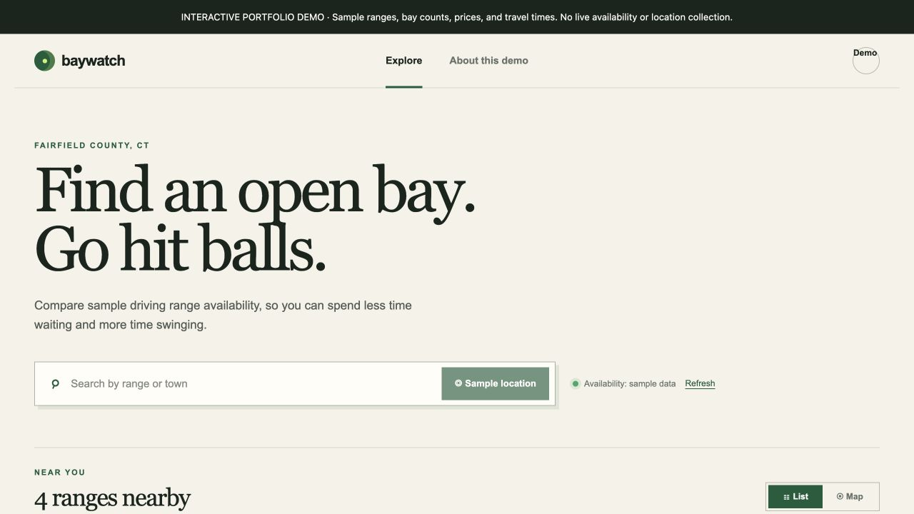
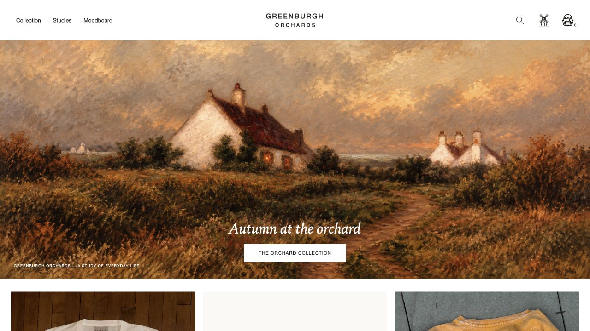
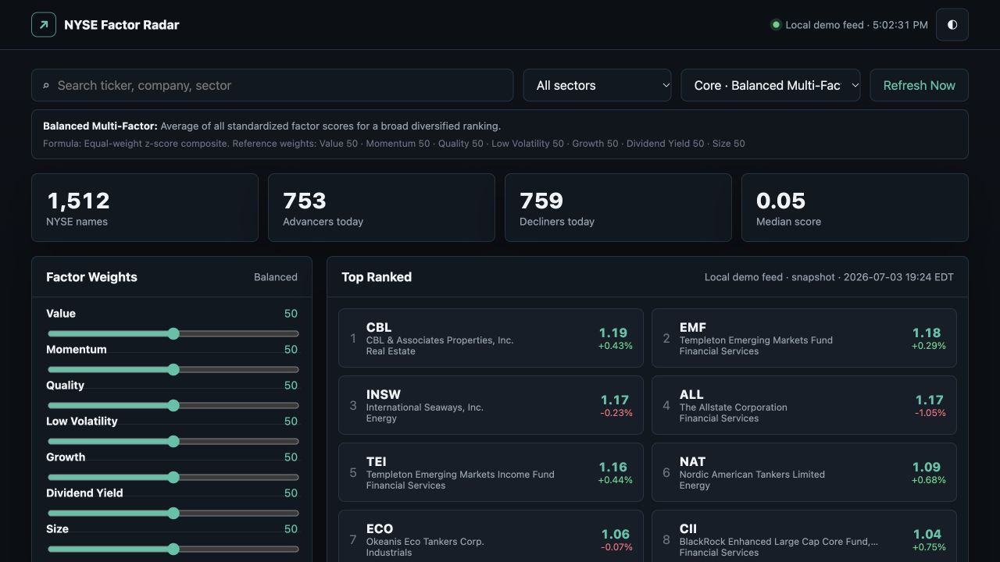

# Web portfolio

Three web projects exploring clearer decisions, thoughtful interfaces, and practical digital experiences.

| Project | What it demonstrates | Explore |
| --- | --- | --- |
| **Baywatch Golf Range Finder** | A range discovery interface combining availability, travel time, and amenity filters | [Demo](https://tcrose18.github.io/web-portfolio/baywatch/) · [Project & source](projects/baywatch-golf-ranges/) |
| **Greenburgh Orchards** | An editorial clothing storefront connecting collections, product details, and a shopping basket | [Demo](https://greenburgh-orchards.kremlindog.chatgpt.site/) · [Project & source](projects/greenburgh-orchards/) |
| **NYSE Factor Radar** | A stock screening interface with adjustable factor models, search, and ranked results | [Demo](https://aiinnov8er.com/) · [Project & source](projects/nyse-factor-radar/) |

## Baywatch Golf Range Finder

Golfers need to compare nearby practice facilities without piecing together availability, travel time, and amenities across separate pages. Baywatch brings those details into a filterable list and map-style view.

**Implementation highlights:** availability indicators, amenity filters, distance comparisons, selected-range highlighting and list/map view switching.

**Demonstrated result:** the sample interface lets visitors compare ranges and narrow their options. Sample availability is illustrative; live range discovery belongs to the separate private service. The original hosted site remains access-restricted.

## Greenburgh Orchards

A small clothing collection needs a distinct identity while keeping product discovery and purchasing understandable. This storefront combines seasonal artwork and editorial pages with product selection and a basket.

**Implementation highlights:** collection navigation, product dialogs, size selection, basket state, checkout validation, and server-side order handling.

**Demonstrated result:** visitors can explore an item, select a size, add it to their basket, and reach an order summary. Payment is arranged separately; the demo is not presented as an integrated payment gateway. Do not submit a real order during review.

## NYSE Factor Radar

Comparing a large set of securities becomes difficult when the ranking criteria are hidden. This dashboard exposes factor weights and model descriptions alongside a searchable, sortable table.

**Implementation highlights:** factor scoring and standardization, model presets, adjustable weights, sector filtering, ticker search, and a quote API with a local fallback.

**Demonstrated result:** reviewers can find a company and explore how ranking controls affect the interface. During verification, the hosted app used its local demo feed and displayed a July 3, 2026 snapshot. Treat it as an interface demonstration rather than current market information.

## Review the projects

Source files are organized under `projects/`. Each project has its own setup notes and a short demo walkthrough. [Verification notes](DEMO-CHECKS.md) distinguish tested interactions from configured or untested services.

The examples focus on the implemented interfaces and workflows. Each project guide explains its setup, source structure, and demo scope.
